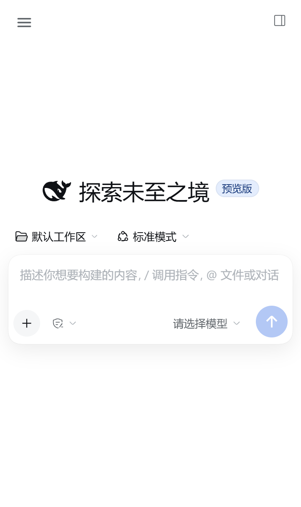
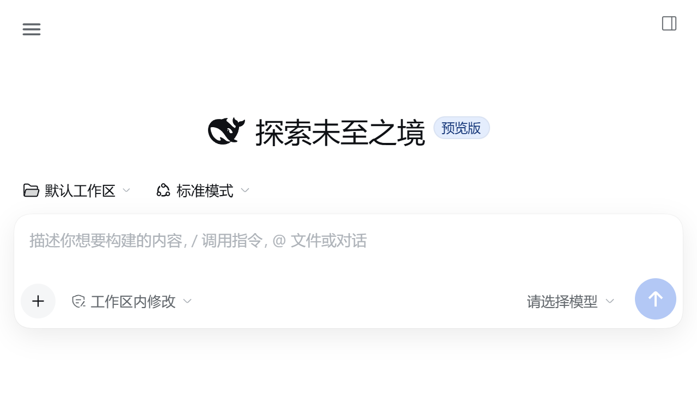
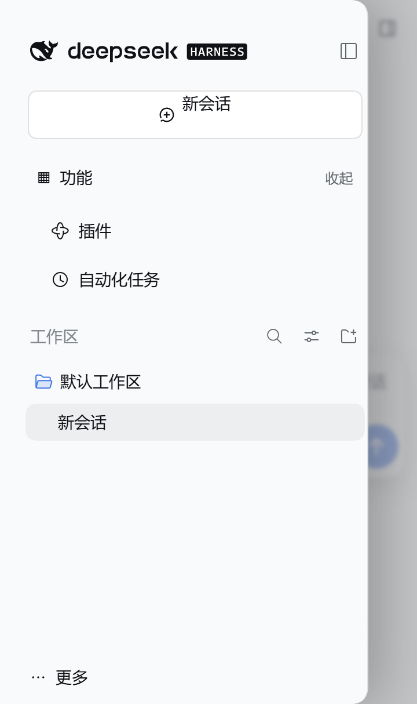

# DSH Android Auto

This repository builds a private-signing Android release of DeepSeek Harness and
follows the official DeepSeek Harness release feed.

Current release: `v1.45.3`, with DSH `0.2.1-rc.2`.

| Portrait 16:9.5 | Landscape 16:9.5 | Navigation drawer |
| --- | --- | --- |
|  |  |  |

## Mobile UI

The Android UI is tuned for a 16:9.5 display in both orientations:

- the collapsed sidebar rail no longer consumes content width;
- navigation uses a full-height overlay drawer with a visible 48px hit area and
  Android hardware-back dismissal, without competing with system edge gestures;
- the header is reduced to 48px portrait / 44px landscape;
- the conversation and composer use nearly the full viewport width;
- safe-area, software-keyboard, touch-target and landscape rules are bundled;
- Android system font scaling is passed into WebView (85%–150%, safely clamped);
- the boot screen uses cover scaling, so the display is not letterboxed.

The source of the mobile override is under [`ui/`](ui/).
See the full [16:9.5 UI/UX audit](docs/ui-audit-16x9.5.md) for measurements and
the remaining physical-device checks.

## Update model

1. GitHub Actions checks the official `deepseek-ai/deepseek-harness` releases.
2. It checks the maintained Android port and reads the DSH kernel version
   embedded in the latest APK.
3. A new Android build is published only after the Android port contains the
   same (or a newer) DSH kernel. This compatibility gate prevents a desktop-only
   update from breaking the Android shell.
4. The app checks this repository for a newer signed APK and verifies its
   published SHA-256 before installing it.

The official project does not publish Android APKs. Directly installing a
desktop release on Android is not possible, so a small adaptation delay is
expected whenever the official engine changes.

## Repository visibility

The repository and its Releases must be publicly readable for an installed
Android app to check updates without embedding a GitHub token. A private
repository can still run the build workflow, but cannot serve anonymous update
checks to the phone.

This repository is public and contains build sources, workflows, release notes,
and signed APKs. Signing keys are stored only in repository secrets and are
never committed.

## Build

Run the `Build signed APK` workflow manually with:

- `port_tag`: the Android adaptation release tag, for example `v1.45`
- `app_version`: this repository's release version, for example `1.45.1`
- `app_code`: a monotonically increasing Android version code
- `upstream_version`: the DSH kernel embedded in the APK

The workflow downloads the pinned Android base APK, compiles the Android shell
with the update endpoint pointed at this repository, patches the bundled Web UI,
signs it with the repository release key, verifies it, and publishes a GitHub
Release.

## Required secrets

- `ANDROID_KEYSTORE_B64`: base64 PKCS#12 signing keystore
- `ANDROID_KEYSTORE_PASSWORD`: keystore password
- `ANDROID_KEY_ALIAS`: signing key alias
- `ANDROID_KEY_PASSWORD`: key password

Never change the signing key after the first public release. Changing it makes
over-the-air updates impossible without uninstalling the app and deleting its
private data.

## Source and licenses

The Android shell and compatibility patches come from
`guzhou079-arch/deepseek-harness-android` (MIT). DeepSeek Harness is an
independent project by DeepSeek. See [NOTICE.md](NOTICE.md).
