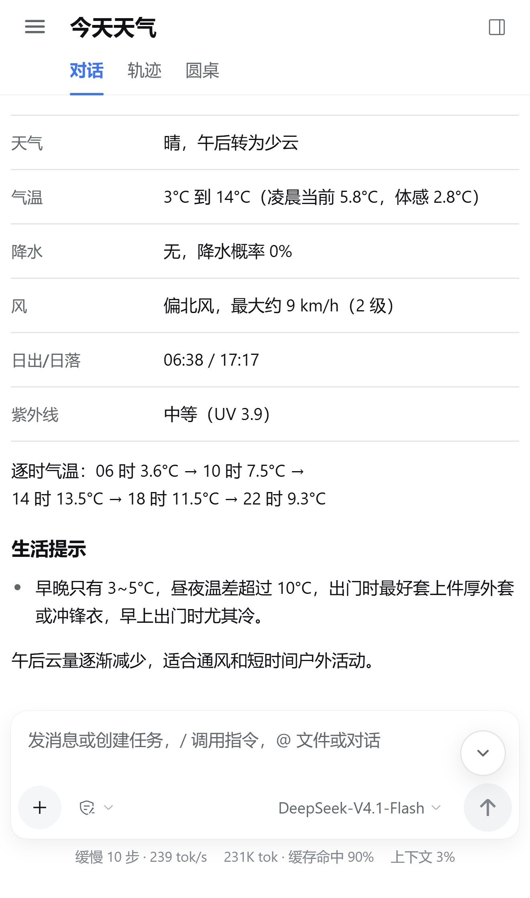
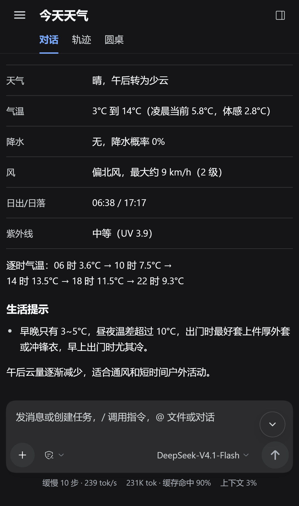
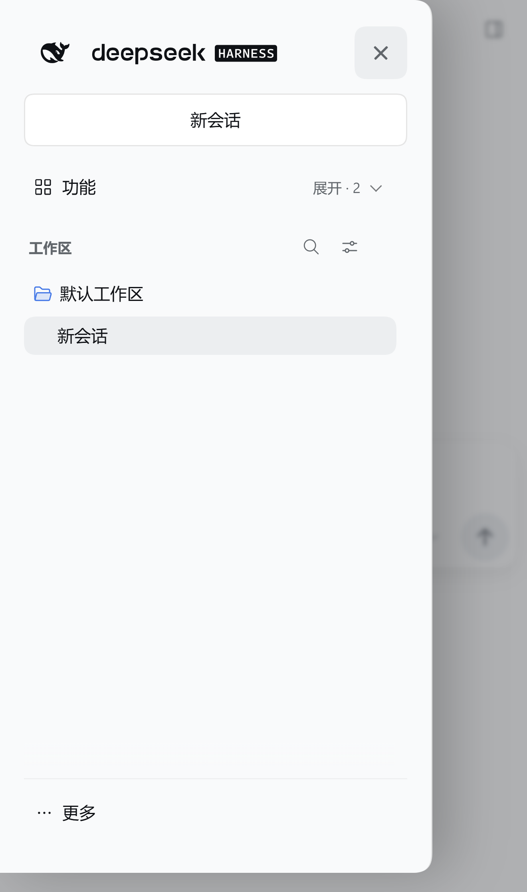
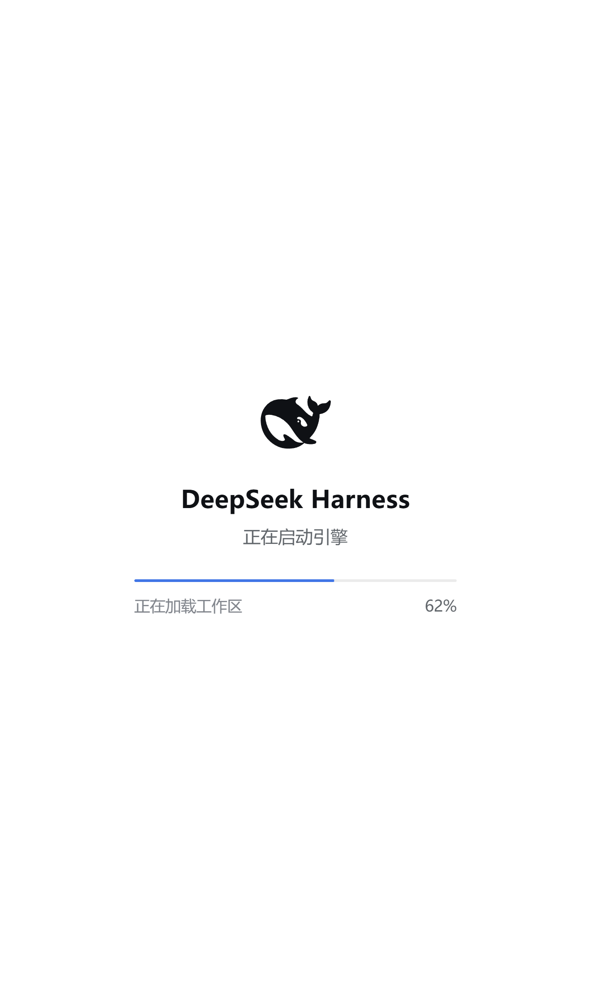
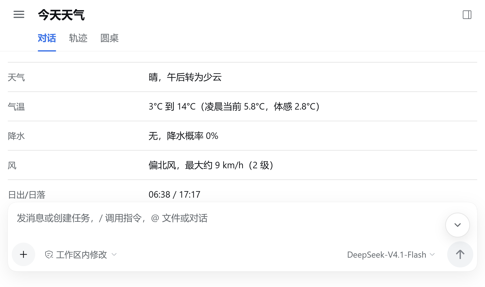
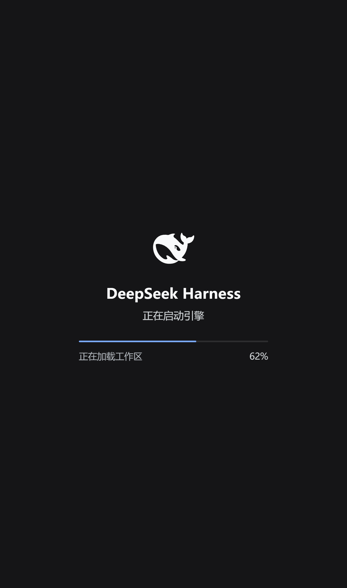

# DSH Android Auto

This repository builds a private-signing Android release of DeepSeek Harness and
follows the official DeepSeek Harness release feed.

Current release: `v1.45.9`, with DSH `0.2.1-rc.2`.

| Portrait 440 × 744 | Dark answer | Navigation drawer |
| --- | --- | --- |
|  |  |  |
|  |  |  |

## Mobile UI

The primary geometry comes from the supplied 1320 × 2232 device capture,
which maps to a 440 × 744 CSS viewport at 3× density:

- the collapsed sidebar rail no longer consumes content width;
- navigation uses a full-height overlay drawer with a visible 48px hit area and
  Android hardware-back dismissal, without competing with system edge gestures;
- the header is reduced to 48px portrait / 44px landscape;
- the title and tab baseline share the same 58px leading edge, while the answer
  and composer share a single 9px content gutter;
- answer text uses zero tracking, strict CJK line breaking and a 30/70 table
  split so values do not collapse into orphan-character lines;
- the model label receives enough width to stay readable instead of clipping
  the model name;
- the composer keeps a 12px minimum bottom clearance and its metadata remains
  above Android's gesture area;
- the return-to-bottom control moves into the quiet upper-right composer area,
  where it cannot cover prose;
- the drawer uses symmetric 20px inner gutters, a conventional close cross,
  a vector disclosure icon and a safe bottom utility row;
- the duplicate clickable logo action is removed from mobile accessibility,
  while focus moves to Close on open and back to Menu on dismiss;
- the New Conversation capsule contains only its centered label; the add glyph
  and invisible keyboard shortcut no longer shift it off-center;
- live Markdown is enhanced incrementally during idle time instead of rescanning
  the whole document on every streamed token;
- typing no longer performs synchronous composer geometry reads on every
  keystroke;
- live backdrop blur was removed from menus, selectors, fixed controls and the
  drawer scrim; these surfaces now use solid semantic DSH fills;
- WebView uses an explicit hardware layer, no overscroll glow or host
  scrollbars, and foreground renderer priority;
- safe-area, software-keyboard, touch-target and landscape rules are bundled;
- Android system font scaling is passed into WebView (85%–150%, safely clamped);
- the boot screen uses cover scaling, so the display is not letterboxed.

The source of the mobile override is under [`ui/`](ui/).
See the full [real-device UI/UX audit](docs/ui-audit-real-device.md) for measurements and
the remaining physical-device checks.
See [the performance audit](docs/performance-audit.md) for before/after timings.
Shared visual rules live in the
[DSH Mobile design system](design-system/dsh-mobile/MASTER.md).

## Update model

1. GitHub Actions checks the official `deepseek-ai/deepseek-harness` releases.
2. It checks the maintained Android port and reads the DSH kernel version
   embedded in the latest APK.
3. A new Android build is published only after the Android port contains the
   same (or a newer) DSH kernel. This compatibility gate prevents a desktop-only
   update from breaking the Android shell.
4. The app checks this repository for a newer signed APK and verifies its
   published SHA-256 before installing it.

The official project does not publish Android APKs. Directly installing a
desktop release on Android is not possible, so a small adaptation delay is
expected whenever the official engine changes.

## Repository visibility

The repository and its Releases must be publicly readable for an installed
Android app to check updates without embedding a GitHub token. A private
repository can still run the build workflow, but cannot serve anonymous update
checks to the phone.

This repository is public and contains build sources, workflows, release notes,
and signed APKs. Signing keys are stored only in repository secrets and are
never committed.

## Build

Run the `Build signed APK` workflow manually with:

- `port_tag`: the Android adaptation release tag, for example `v1.45`
- `app_version`: this repository's release version, for example `1.45.1`
- `app_code`: a monotonically increasing Android version code
- `upstream_version`: the DSH kernel embedded in the APK

The workflow downloads the pinned Android base APK, compiles the Android shell
with the update endpoint pointed at this repository, patches the bundled Web UI,
signs it with the repository release key, verifies it, and publishes a GitHub
Release.

## Required secrets

- `ANDROID_KEYSTORE_B64`: base64 PKCS#12 signing keystore
- `ANDROID_KEYSTORE_PASSWORD`: keystore password
- `ANDROID_KEY_ALIAS`: signing key alias
- `ANDROID_KEY_PASSWORD`: key password

Never change the signing key after the first public release. Changing it makes
over-the-air updates impossible without uninstalling the app and deleting its
private data.

## Source and licenses

The Android shell and compatibility patches come from
`guzhou079-arch/deepseek-harness-android` (MIT). DeepSeek Harness is an
independent project by DeepSeek. See [NOTICE.md](NOTICE.md).
